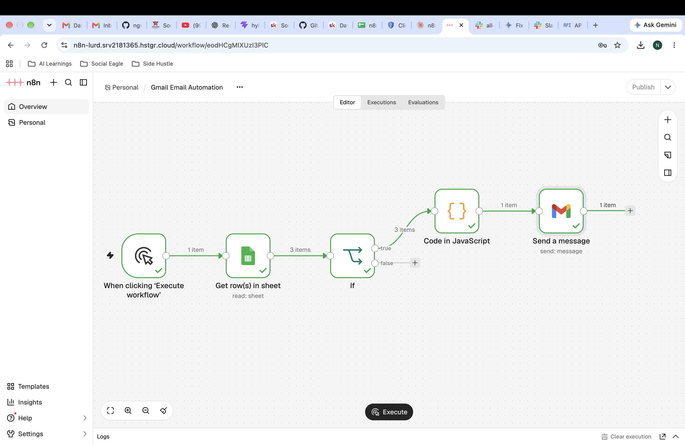
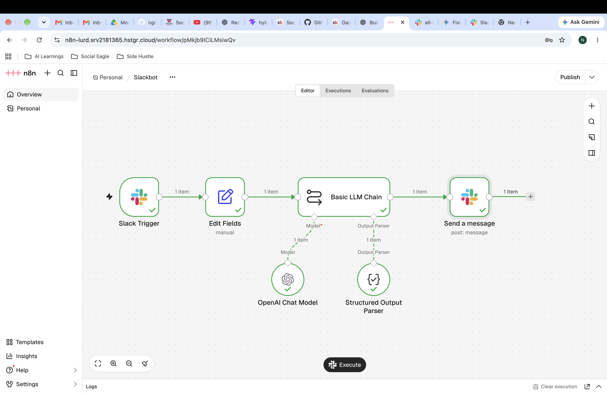
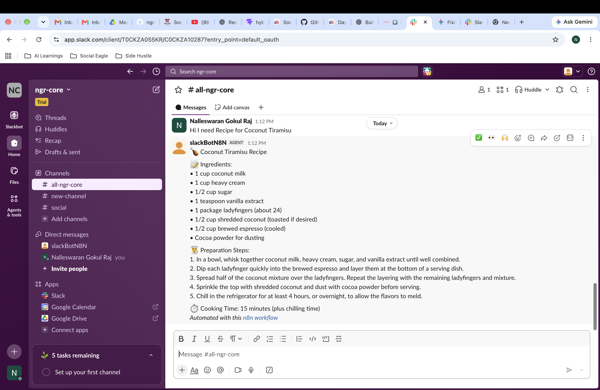

# Gmail & Slack Automations with n8n

This project contains **two separate n8n workflows**. Choose what you want to
try, follow its setup, and run it from n8n:

| I want to... | Open this workflow |
|---|---|
| Email a summary of rows in a Google Sheet | [Gmail Email Automation](#1-gmail-email-automation) |
| Get an AI-generated reply to a Slack message | [Slackbot](#2-slackbot) |

They are independent: import and configure only the workflow you need, or set
up both. Neither workflow is active by default.

## Before you start

You will need an [n8n](https://n8n.io/) instance. Credentials are not included
in the exported JSON files, so connect your own accounts after importing.

| Workflow | Accounts and services needed |
|---|---|
| Gmail Email Automation | Google Sheets and Gmail |
| Slackbot | Slack and OpenAI |

> **Protect your data:** Gmail automation sends spreadsheet values by email.
> Slackbot sends Slack message text to OpenAI to generate a response. Use
> accounts and data you are authorized to share, and never put API keys or
> passwords in workflow exports.

## Pick a workflow

### 1. Gmail Email Automation

**What it does:** When you manually run the workflow, it reads rows from a
Google Sheet, formats a text summary, and emails that summary using Gmail.



#### The journey through the workflow

```text
Click "Execute workflow"
        ↓
Read rows from Google Sheets
        ↓
Are any rows available?
   No ──┴── Yes
   Stop      Format a summary → Send one Gmail
```

It reads the sheet rows and expects each row to contain `name`, `course`, and
`status`. It sends one email with the subject **Data Summary from Google
Sheet**, including a numbered line for each row. If there are no rows, no email
is sent.

#### Set up Gmail automation

1. In n8n, select **Import from File** and import
   [`Gmail Email Automation.json`](./Gmail%20Email%20Automation.json).
2. Open **Get row(s) in sheet** and connect your Google Sheets account.
3. Select the spreadsheet and worksheet you want to summarize.
4. Make sure the sheet's first row has these exact, lowercase column names:

   | `name` | `course` | `status` |
   |---|---|---|
   | Alice | Python | Active |
   | Bob | Data Science | Completed |

5. Open **Send a message**, connect your Gmail account, and change **Send To**
   to the intended recipient. The exported workflow has a sample recipient
   configured.
6. Save the workflow. Click **Execute workflow** to test it.
7. Check the recipient's inbox and the execution details in n8n.

The included [`n8n Assignment Data.xlsx`](./n8n%20Assignment%20Data.xlsx) is an
Excel workbook. This workflow reads a **Google Sheet**, not a local Excel file:
upload/convert the workbook to Google Sheets, then select that Google Sheet in
the node.

#### Example email

[Open the example Gmail summary (PDF)](./Gmail%20-%20Data%20Summary%20from%20Google%20Sheet.pdf)

### 2. Slackbot

**What it does:** When someone sends a message in the configured Slack
channel, the workflow sends the text to an OpenAI model, parses a structured
response, and posts a reply in that channel.



#### The journey through the workflow

```text
Post a message in the selected Slack channel
        ↓
Extract the message text
        ↓
OpenAI interprets the request and creates structured output
        ↓
Post a reply in Slack
```

The prompt is designed for questions, summaries, tasks, recipes, and general
conversation. The model is set to `gpt-4o-mini`, with web search enabled.
**Important:** the current **Send a message** node formats the response using
recipe fields (title, ingredients, steps, and cooking time). A recipe request
is the best end-to-end test. To support other response types in Slack, update
that node's message formatting to match the structured output.

#### Set up Slackbot

1. In n8n, select **Import from File** and import
   [`Slackbot.json`](./Slackbot.json).
2. In your Slack workspace, create or configure a Slack app that can receive
   message events in your chosen channel and post messages there.
3. Invite/add the app to that channel.
4. In n8n, connect your Slack account to both **Slack Trigger** and
   **Send a message**.
5. Select the **same channel** in both nodes. The exported workflow points to
   an example channel; choose a channel in your own workspace.
6. Connect your OpenAI credential to **OpenAI Chat Model**.
7. Save and activate/publish the workflow.
8. Post a recipe request in the selected channel, for example:

   > Can you give me a recipe for coconut tiramisu?

9. Confirm the bot's reply appears in the channel and inspect the execution in
   n8n if it does not.

Your Slack app needs the appropriate permissions and event subscriptions for
the channel type you use. Follow your workspace's Slack app installation and
approval process.

#### Example Slack reply



## What's in this folder?

| File | Purpose |
|---|---|
| `Gmail Email Automation.json` | Importable Google Sheets-to-Gmail workflow |
| `Slackbot.json` | Importable Slack-to-OpenAI reply workflow |
| `n8n Assignment Data.xlsx` | Example source workbook for the Gmail workflow |
| `Email-automation-n8n-workflow.png` | Gmail workflow screenshot |
| `Gmail - Data Summary from Google Sheet.pdf` | Example Gmail summary |
| `slack-automation-n8n-workflow.png` | Slack workflow screenshot |
| `slack-bot-reply.png` | Example Slackbot reply |

## If something goes wrong

| Problem | Try this |
|---|---|
| A node asks for a credential | Select or create your own account credential in n8n. Exported credentials cannot be reused from another n8n instance. |
| Gmail sends no summary | Confirm there are rows in the selected Google Sheet and that the column names are `name`, `course`, and `status`. Check the **If** node and Gmail execution. |
| Gmail sends to the wrong person | Update **Send To** in the Gmail **Send a message** node before executing. |
| Slackbot does not trigger | Confirm the workflow is active, the Slack app is installed in the selected channel, and message events are configured. |
| Slackbot does not post a reply | Check the Slack and OpenAI credentials, channel selection in both Slack nodes, and the n8n execution details. |
| A non-recipe Slack request has an incomplete reply | The current Slack message template expects recipe fields. Update **Send a message** to format other structured response categories. |

## Want to customize a workflow?

- In Gmail automation, edit the JavaScript in **Code in JavaScript** to change
  the summary format, or change the subject and recipient in **Send a message**.
- In Slackbot, edit the prompt in **Basic LLM Chain** to change how messages
  are answered. Update **Send a message** as well if your new output format
  differs from the recipe layout.
